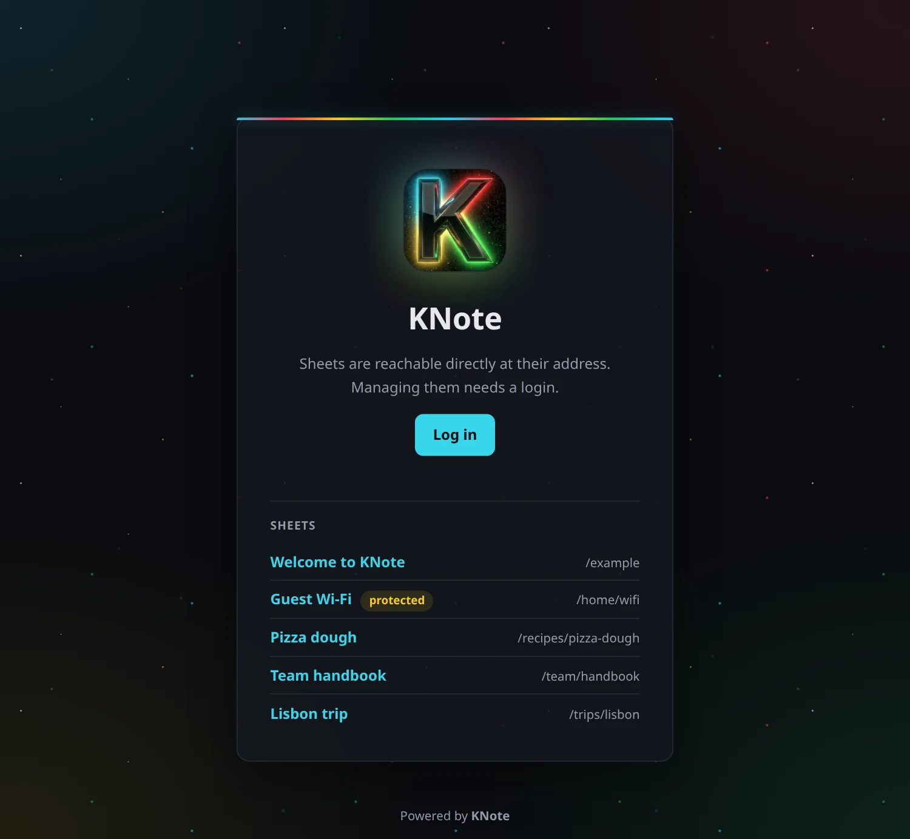
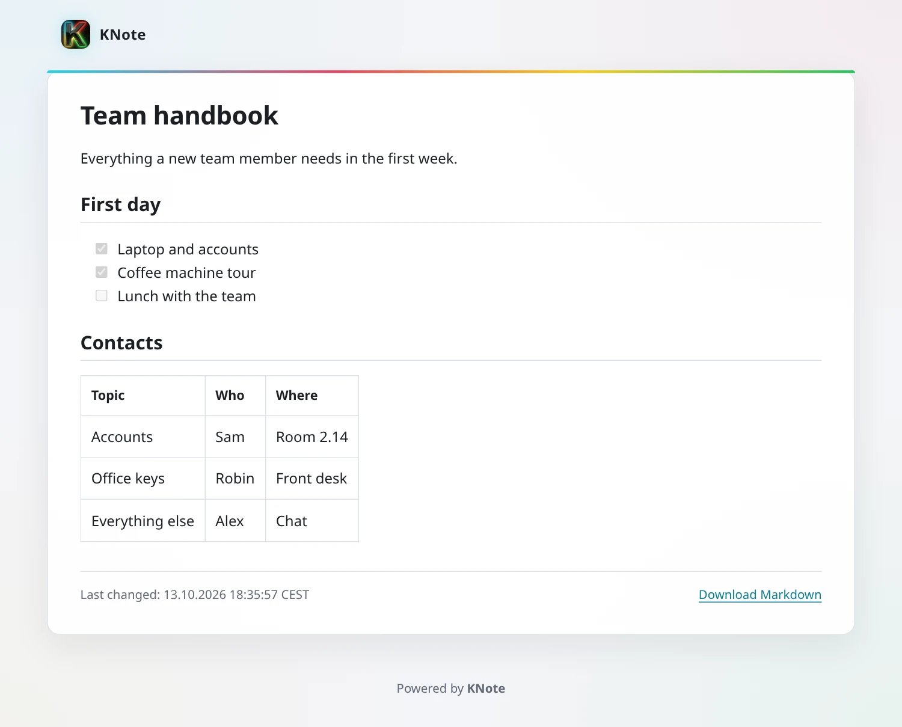
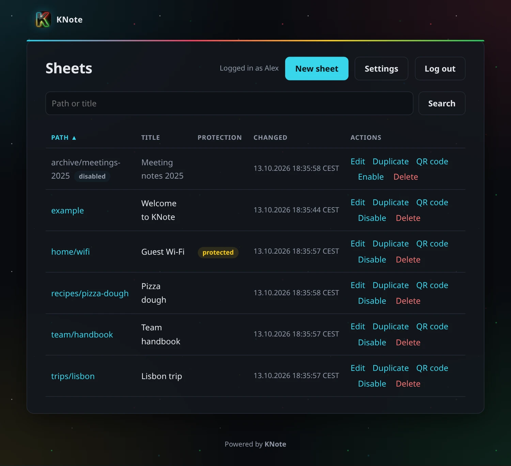

# KNote

[](https://github.com/nexus421/KNote/actions/workflows/test.yml)


**K**otlin **Note**s: a small self hosted note service. Every note (a sheet) lives at its own URL and is readable
without login. A sheet can have its own password, then it is stored encrypted. Managing sheets needs an admin login
through OIDC.

<p align="center"></p>

## Features

* Markdown with tables, strikethrough, task lists and autolinks, preview in the editor
* Every sheet shows its last change and can be downloaded as Markdown, with a clean print layout
* Any path per sheet, e.g. `https://notes.example.org/projects/knote`
* Optional password per sheet, content encrypted with AES-GCM
* Admin login through an OIDC provider such as Pocket ID, limited to the listed accounts
* Search, sort, duplicate and disable sheets in the admin area, QR code with logo for every sheet
* Optional list of sheets on the start page, chosen in the settings
* Rate limits on password attempts and login
* English and German interface, more languages are easy to add
* No database, no JavaScript: one JSON file per sheet, one config file, one JAR

<p align="center">
  
  
</p>

## Getting started

Requirements: Java 25 (Amazon Corretto recommended), an OIDC provider and a reverse proxy for TLS (e.g. Zoraxy,
Caddy or nginx).

```bash
curl -LO https://github.com/nexus421/KNote/releases/latest/download/knote.jar
curl -o config.json https://raw.githubusercontent.com/nexus421/KNote/master/config.example.json
java -jar knote.jar key         # value for sessionSignKey
java -jar knote.jar check       # validates config.json
java -jar knote.jar
```

Fill in `config.json` before the check: your public URL, the session key, the OIDC client and the address of your
reverse proxy and who is admin. Register KNote at your OIDC provider with the callback `<public URL>/_auth/callback`
(see [Deployment](docs/deployment.md#5-who-may-log-in)).
For a local try without TLS, `http://localhost:8080` works as public URL. On its first start KNote creates an
example sheet at `/example`.

To build the JAR yourself, run `./gradlew buildFatJar`, it ends up in `build/libs/`. Tests: `./gradlew test`, also
run on every push.

## Documentation

* [Configuration and command line](docs/configuration.md)
* [Deployment](docs/deployment.md): systemd, reverse proxy, OIDC client, who may log in
* [How it works](docs/how-it-works.md): endpoints, encryption, login, security

## Note on AI

KNote was written with the help of an AI coding assistant (Claude). Concept and review by the author. The code is
covered by automated tests, but has not had an independent security audit.
